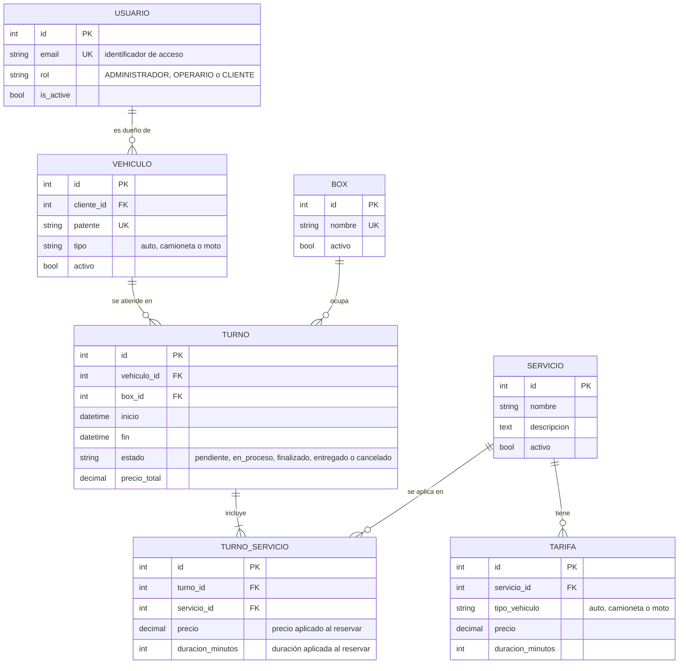

# Sistema Lavadero

Sistema de gestión para un lavadero de vehículos: los clientes registran sus vehículos y reservan turnos eligiendo servicios y horario de inicio, y el personal del lavadero administra la agenda, el catálogo de servicios con sus precios, los boxes y los usuarios.

Proyecto Integrador de Práctica Profesionalizante II (Tecnicatura Superior en Desarrollo de Software, 2026).

## Qué hace el sistema

| Rol | Puede |
|---|---|
| **Cliente** | Registrarse, iniciar sesión, administrar sus vehículos, reservar turnos eligiendo vehículo, servicios y horario de inicio, ver y cancelar sus turnos |
| **Operario** | Ver la agenda de todos los turnos y avanzar su estado |
| **Administrador** | Todo lo del operario, más gestionar servicios, tarifas por tipo de vehículo, boxes y usuarios, y ver el resumen de turnos e ingresos |

Al reservar, el cliente elige solo el horario de inicio: el sistema calcula el precio y el horario de fin según los servicios y el tipo de vehículo, y asigna un box libre.

## Stack

| Capa | Tecnología |
|---|---|
| Backend | Python, Django y Django REST Framework, gestionado con `uv` |
| Autenticación | JWT (`djangorestframework-simplejwt`) con renovación y lista negra de refresh tokens |
| Documentación de la API | OpenAPI y Swagger con `drf-spectacular` |
| Base de datos | PostgreSQL |
| Frontend | Next.js (App Router, JavaScript) y Tailwind CSS |
| Calidad | `pytest` y `ruff` en el backend, `eslint` en el frontend |
| Despliegue | Vercel (frontend) y Render (backend y Postgres) |

Arquitectura desacoplada: el frontend consume la API REST (prefijo `/api/`) y no accede a la base de datos. El backend se organiza en una app de Django por bloque: `usuarios`, `catalogo` y `turnos`.

## Estructura del repositorio

```text
Sistema-Lavadero/
├── backend/ # Django y DRF (ver backend/README.md)
│ ├── usuarios/ # registro, login, permisos por rol, gestión de usuarios
│ ├── catalogo/ # vehículos, servicios, tarifas y boxes
│ ├── turnos/ # turnos, reglas de negocio, agenda y resumen
│ └── config/ # configuración, rutas y health check
├── frontend/ # Next.js
├── docs/ # contratos de la API y matriz de permisos
└── .github/ # plantilla de Pull Request
```


## Puesta en marcha local

Requisitos: Python 3.13 o superior, [`uv`](https://docs.astral.sh/uv/getting-started/installation/), PostgreSQL 16 o superior (con Docker o instalado) y Node.js 20 o superior.

### 1. Backend

La base de datos, las variables de entorno y los problemas frecuentes están explicados paso a paso en [`backend/README.md`](backend/README.md). En resumen:

```bash
cd backend
cp .env.example .env              # completar SECRET_KEY (ver backend/README.md)
uv sync
uv run python manage.py migrate
uv run python manage.py cargar_datos
uv run python manage.py runserver
```

- Health check: <http://localhost:8000/api/health/>
- Swagger: <http://localhost:8000/api/docs/>

### 2. Frontend

```bash
cd frontend
cp .env.example .env.local        # NEXT_PUBLIC_API_URL=http://localhost:8000
npm install
npm run dev
```

La aplicación queda en <http://localhost:3000>.

### 3. Datos de ejemplo

`uv run python manage.py cargar_datos` carga 2 boxes, 4 servicios con sus tarifas por tipo de vehículo y tres usuarios de prueba (más un vehículo para el cliente). Se puede ejecutar varias veces: no duplica datos ni pisa contraseñas ya cambiadas.

| Rol | Email | Contraseña |
|---|---|---|
| Administrador | `admin@lavadero.test` | `Lavadero123!` |
| Operario | `operario@lavadero.test` | `Lavadero123!` |
| Cliente | `cliente@lavadero.test` | `Lavadero123!` |

Son credenciales **solo para desarrollo**. Con `DEBUG=False` el comando se niega a correr salvo que se use `--forzar`.

### Pantallas

| Ruta | Quién | Qué hace |
|---|---|---|
| `/login` y `/registro` | Público | Iniciar sesión y registrar un cliente |
| `/turnos` | Cliente | Mis turnos, con cancelación |
| `/turnos/nuevo` | Cliente | Reservar un turno |
| `/vehiculos` | Cliente | Mis vehículos |
| `/agenda` | Administrador y operario | Agenda con filtros y avance de estado |
| `/resumen` | Administrador | Turnos e ingresos de un período |
| `/admin/servicios` | Administrador | Servicios con tarifas por tipo de vehículo |
| `/admin/boxes` | Administrador | Boxes |
| `/admin/usuarios` | Administrador | Usuarios y roles |

Después de iniciar sesión, el cliente va a `/turnos` y el personal a `/agenda`.

## Roles y permisos

Cada endpoint valida el rol **en el backend**, no solo en la interfaz (`backend/usuarios/permisos.py`). La matriz completa está en [`docs/permisos-roles.md`](docs/permisos-roles.md).

| Acción | Administrador | Operario | Cliente |
|---|---|---|---|
| Gestionar usuarios y roles | Sí | No | No |
| Gestionar servicios, tarifas y boxes | Sí | No | No |
| Ver el resumen de turnos e ingresos | Sí | No | No |
| Ver la agenda de todos los turnos | Sí | Sí | No |
| Cambiar el estado de un turno | Sí | Sí | No |
| Registrar y administrar vehículos propios | No | No | Sí |
| Reservar, ver y cancelar turnos propios | No | No | Sí |

Un cliente nunca puede ver ni modificar datos de otro: los recursos ajenos devuelven 404.

## API

Todos los endpoints llevan el prefijo `/api/`. La documentación interactiva está en `/api/docs/` y el esquema OpenAPI en `/api/schema/`. El detalle de campos, respuestas y códigos de error de cada grupo está en los contratos de `docs/`.

| Grupo | Rutas principales | Contrato |
|---|---|---|
| Acceso | `POST /api/auth/registro/`, `POST /api/auth/login/`, `POST /api/auth/refresh/`, `POST /api/auth/logout/` y `/api/auth/usuarios/` (administrador) | [`docs/api-acceso.md`](docs/api-acceso.md) |
| Catálogo | `GET /api/catalogo/`, `/api/vehiculos/`, `/api/servicios/` (con tarifas anidadas) y `/api/boxes/` | [`docs/api-catalogo.md`](docs/api-catalogo.md) |
| Turnos | `POST` y `GET /api/turnos/`, `GET /api/turnos/{id}/`, `PATCH /api/turnos/{id}/estado/`, `POST /api/turnos/{id}/cancelar/` y `GET /api/resumen/` | [`docs/api-turnos.md`](docs/api-turnos.md) |

Convenciones comunes:

- Errores de validación: **400** con `{"campo": ["mensaje"]}`. Sin sesión: **401**. Rol no permitido: **403**. Recurso inexistente o ajeno: **404**. Conflicto (por ejemplo, sin box libre): **409**. Los demás errores devuelven `{"detail": "mensaje"}`.
- `DELETE` hace baja lógica (`activo=false`) y nunca borra la fila.
- Los importes viajan como texto con dos decimales (`"12500.00"`) y las fechas en ISO 8601 UTC. El frontend las muestra en hora de Argentina (`America/Argentina/Buenos_Aires`).
- Los listados van paginados de a 20 elementos.

## Modelo de datos

Siete entidades vinculadas por claves foráneas. Vehículos, servicios, tarifas, boxes y turnos tienen baja lógica.



Restricciones que garantiza la base de datos:

- **Tarifa:** una sola por servicio y tipo de vehículo, con precio y duración mayores a 0.
- **Turno:** dos turnos no cancelados no pueden superponerse en el mismo box (`ExclusionConstraint` de Postgres), el fin es posterior al inicio y el precio no es negativo.
- **Turno y servicio:** un servicio no se repite dentro de un mismo turno, y `TurnoServicio` guarda el precio y la duración del momento de la reserva, de modo que un cambio posterior de tarifa no altera turnos ya reservados.
- Los registros con turnos asociados nunca se borran (`PROTECT`): se inactivan.

## Reglas de negocio y cómo se prueban

1. **No superposición:** dos turnos no cancelados no pueden ocupar el mismo box a la vez. Está garantizado en la base y probado en `backend/turnos/`. Sin box libre, la API responde 409.
2. **Cálculo automático:** el precio es la suma de la tarifa de cada servicio según el tipo de vehículo, y el fin es el inicio más la suma de las duraciones. El turno tiene que empezar y terminar dentro del horario de atención (8:00 a 20:00, hora de Argentina).
3. **Flujo de estados:** pendiente, en proceso, finalizado y entregado, sin saltos ni retrocesos. Solo se puede cancelar un turno pendiente.
4. **Baja lógica:** un servicio, box o vehículo con turnos asociados no se elimina, se inactiva. Además, no se puede cambiar el tipo de un vehículo que tiene turnos pendientes o en proceso.
5. **Propiedad de los datos:** un cliente solo ve, modifica y cancela sus propios turnos y vehículos.

## Tests y calidad

```bash
# Backend (necesita Postgres y el .env; ver backend/README.md)
cd backend
uv run pytest
uv run ruff check .

# Frontend
cd frontend
npm run lint
npm run build
```

Los tests del backend corren contra Postgres porque la regla de no superposición no funciona con SQLite. Cada endpoint se prueba como mínimo con el caso correcto, 401 sin sesión, 403 con un rol no permitido, 400 con datos inválidos y 404 con un recurso ajeno.

## Seguridad

- Ningún secreto está en el repositorio: la configuración sale de variables de entorno y cada parte versiona su `.env.example`.
- `DEBUG=False` en producción, `ALLOWED_HOSTS` y CORS acotados a los dominios del proyecto.
- La validación de datos y de permisos se hace en el backend; el frontend valida solo para mejorar la experiencia.
- Las respuestas nunca incluyen contraseñas ni datos de otros clientes.

### Dónde se guardan los tokens JWT

El frontend guarda la sesión (`access` y `refresh`) en `sessionStorage` (`frontend/src/lib/auth.js`).

- **Por qué:** es simple, no obliga a configurar cookies entre dos dominios distintos (Vercel y Render) ni a manejar CSRF, y la sesión se pierde al cerrar la pestaña.
- **Riesgo:** cualquier script que se ejecute en la página (XSS) puede leer los tokens. Se reduce porque React escapa lo que muestra y el frontend no usa `dangerouslySetInnerHTML`, el `access` tiene un vencimiento corto y el `refresh` se revoca al cerrar sesión (lista negra). Las duraciones están en [`docs/api-acceso.md`](docs/api-acceso.md).
- **Alternativa más segura:** guardar los tokens en una cookie `httpOnly` con `SameSite` y protección CSRF. No se implementó para mantener el alcance del MVP y queda como mejora.

## Despliegue

El frontend se despliega en Vercel y el backend, junto con su base Postgres, en Render, siempre desde la rama `main`. En producción valen las mismas variables que en `backend/.env.example`, con `DEBUG=False`, los dominios reales en `ALLOWED_HOSTS` y `CORS_ALLOWED_ORIGINS`, y una `SECRET_KEY` propia (nunca la de desarrollo).

**URLs de producción:**

- Frontend (Vercel): <https://sistema-lavadero.vercel.app/>
- API (Render): <https://sistema-lavadero.onrender.com> (documentación en `/api/docs/`)

El plan gratuito de Render duerme el servicio por inactividad: la primera petición puede tardar entre 30 y 60 segundos.

## Flujo de trabajo del equipo

- Ramas `feature/<n°-issue>-...`, `bugfix/...` y `docs/...` creadas desde `develop`. Nunca se commitea directo en `develop` ni en `main`, y ambas están protegidas.
- Commits chicos con Conventional Commits (`feat(turnos): ...`, `fix(auth): ...`, `test(...)`, `docs: ...`).
- Un Pull Request por tarea a `develop`, con la descripción de la plantilla (`Refs #n` en los intermedios y `Closes #n` en el último), 1 aprobación de otra persona y merge commit, sin squash, para conservar los commits de cada integrante. La revisión es en ronda: Mateo revisa a Gonzalo, Gonzalo a Facundo y Facundo a Mateo.
- Tablero Kanban en GitHub Projects con una tarjeta por historia o tarea.
- Las ramas se conservan después del merge como registro del trabajo.

## Acceso y sesión

### Inicio de sesión (HU-A2)

El sistema permite iniciar sesión mediante correo electrónico y contraseña.

**Endpoint:** `POST /api/auth/login/`

Cuando las credenciales son correctas, el backend devuelve dos tokens JWT (`access` y `refresh`) junto con los datos del usuario, incluido su rol.

El frontend utiliza `apiFetch` para comunicarse con la API y almacena la sesión en `sessionStorage` bajo la clave `lavadero_sesion` (ver la sección «Seguridad»).

Las peticiones autenticadas incluyen el token de acceso en el encabezado `Authorization: Bearer <token>`.

Después de iniciar sesión, los clientes son redirigidos a `/turnos` y los administradores y operarios a `/agenda`.

**Pruebas realizadas:**
- Inicio de sesión correcto: HTTP 200.
- Contraseña incorrecta: HTTP 401.
- Usuario inactivo: HTTP 401.
- Tests automatizados con pytest.
- Integración comprobada entre Django y Next.js.

### Renovación y cierre de sesión (HU-A3)

El sistema permite renovar automáticamente el token de acceso y cerrar sesión.

**Endpoints:**
- `POST /api/auth/refresh/`: recibe un refresh válido y devuelve un nuevo access.
- `POST /api/auth/logout/`: requiere autenticación y recibe el refresh para incorporarlo a la blacklist.

En el frontend, `apiFetch` detecta respuestas HTTP 401 de peticiones autenticadas e intenta renovar el access utilizando el refresh almacenado en `sessionStorage`. Si la renovación funciona, actualiza el token y repite la petición original una sola vez.

Si el refresh es inválido o está vencido, elimina la sesión local y redirige al usuario a `/login` con una notificación.

El botón **Cerrar sesión** revoca el refresh en el backend y elimina los datos de sesión del navegador. El access emitido anteriormente puede seguir siendo válido hasta su vencimiento.

**Pruebas realizadas:**
- Refresh correcto: HTTP 200.
- Logout correcto: HTTP 204.
- Refresh revocado: HTTP 401.
- Renovación automática del access comprobada desde Next.js.
- Redirección al login comprobada ante refresh inválido.
- 106 tests del backend aprobados (al cerrar HU-A3).

## Equipo

| Bloque | Responsable |
|---|---|
| Acceso: registro, login, roles y gestión de usuarios | Mateo |
| Catálogo: servicios, tarifas, boxes, vehículos, seeds y documentación | Gonzalo |
| Turnos: reserva, agenda, estados, resumen, despliegue y cierre | Facundo |